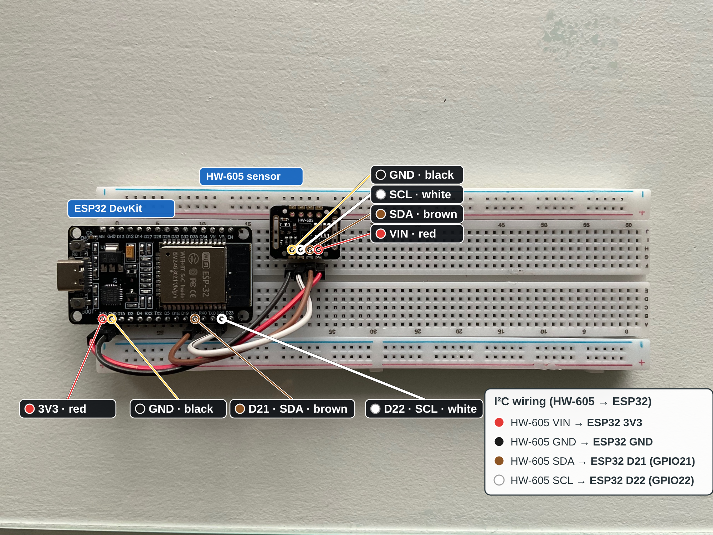
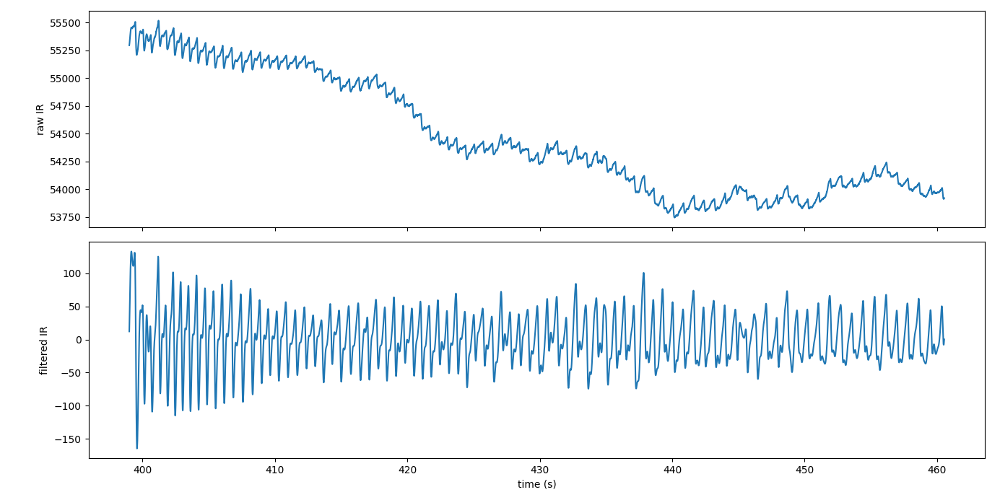
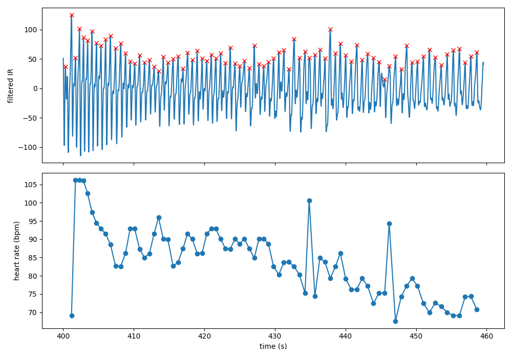
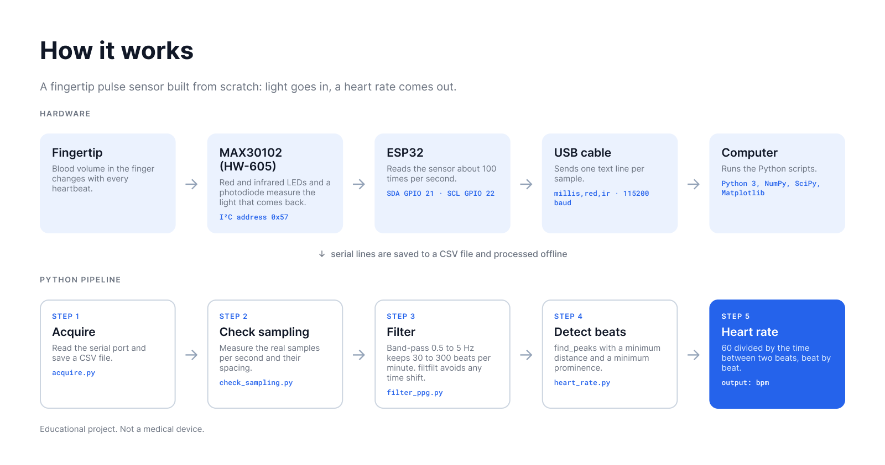
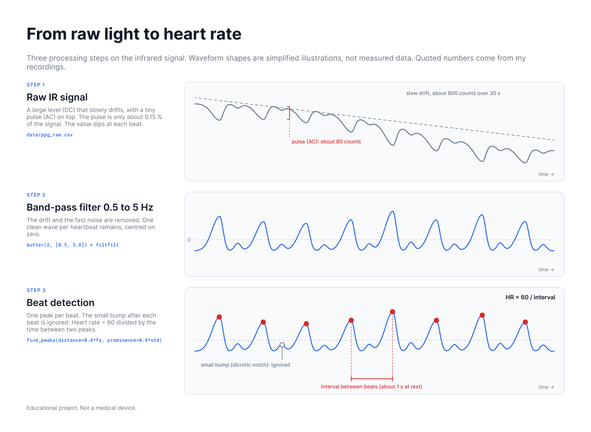
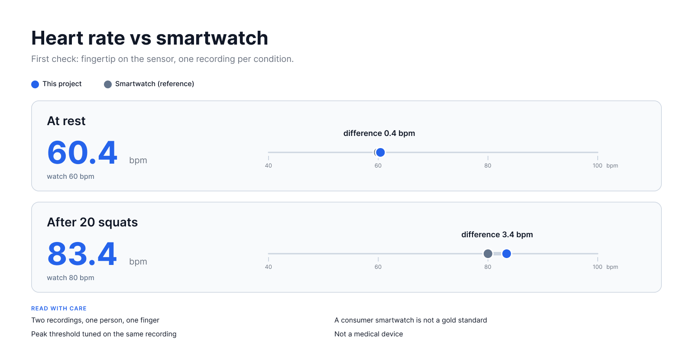

# Self-made PPG heart-rate monitor (ESP32 + MAX30102)

A photoplethysmography (PPG) pulse sensor built from scratch: an ESP32 reads a MAX30102 optical sensor, and a Python pipeline turns the raw light signal into a heart rate. The goal is to understand every step, from the soldering iron to the signal processing, and to document the process honestly.

 



## Why this project

I wanted to understand how wearable devices measure the pulse with light, by building and validating a working system myself instead of using a ready-made library or board.

## Results

Preliminary comparison with a smartwatch (reference), fingertip on the sensor, 60 s recordings:

| Condition | This project | Smartwatch | Difference |
|---|---|---|---|
| Rest | 60.4 bpm | 60 bpm | 0.4 bpm |
| After 20 squats | 83.4 bpm | 80 bpm | 3.4 bpm |

This is a first check on two recordings, not a full validation (see [Limitations](#limitations)).


| Raw vs filtered signal | Detected beats and heart rate |
|---|---|
|  |  |

Measured on my own recordings:
- Real sampling rate: 99.1 Hz (target 100 Hz), regular spacing of about 10 ms between samples.
- The pulse (AC component) is only about 0.15% of the signal level (about 80 counts on a level of 56,000).
- At rest, beat-to-beat heart rate stays between about 57 and 70 bpm once false peaks are removed.

## How it works





1. **Acquire** (`python/acquire.py`): read `millis,red,ir` lines from the serial port, save to CSV.
2. **Check the sampling** (`python/check_sampling.py`): measure the real sampling rate and the spacing between samples. The filter needs the true rate in Hz.
3. **Filter** (`python/filter_ppg.py`): second-order Butterworth band-pass, 0.5 to 5 Hz (30 to 300 beats per minute), applied with `filtfilt` (forward and backward, so beats are not shifted in time). It removes the slow drift and the DC level (low side) and fast noise (high side).
4. **Detect beats and compute heart rate** (`python/heart_rate.py`): `scipy.signal.find_peaks` with a minimum distance of 0.4 s (at most 150 bpm) and a prominence threshold relative to the signal's standard deviation. Heart rate = 60 / time between consecutive peaks. Intervals far from the median interval are rejected.

Key observations:
- With this sensor, more blood in the finger means more light absorbed, so the raw value goes *down* at each beat. Peaks are detected on the filtered signal, where the single main peak before the sharp drop is the cleanest feature.
- A prominence threshold that is too low counts the small bump after each beat (dicrotic notch) as an extra beat, which produces impossible instantaneous rates (126 and 149 bpm at rest). Raising the threshold removed them.

## Hardware

| Part | Notes |
|---|---|
| ESP32 development board (USB-C, CP2102) | "ESP32 Dev Module" in the Arduino IDE |
| MAX30102 module (HW-605) | header pins soldered on the bottom edge: VIN, SDA, SCL, GND |
| Breadboard + 4 jumper wires | |

Wiring (3.3 V only, never 5 V):

| MAX30102 | ESP32 |
|---|---|
| VIN | 3V3 |
| GND | GND |
| SDA | GPIO 21 |
| SCL | GPIO 22 |

<!-- TODO: add a wiring photo: docs/img/wiring.jpg -->


## Quick start

**Firmware**
1. Install the Arduino IDE, the *esp32* board package (Espressif Systems), and the *SparkFun MAX3010x* library.
2. Open `firmware/ppg_acquire/ppg_acquire.ino`, select *ESP32 Dev Module* and your port, upload.
   If the upload hangs on "Connecting...", hold the BOOT button until it starts.
3. Close the Serial Monitor before running Python (only one program can use the port).

**Python**
```bash
python3 -m venv .venv
source .venv/bin/activate
pip install -r requirements.txt

python python/acquire.py          # record 30 s with a finger on the sensor
python python/check_sampling.py
python python/filter_ppg.py
python python/heart_rate.py
```
Set `PORT` in `python/acquire.py` to your serial port (for example `/dev/cu.usbserial-0001` on macOS). A sample recording is provided in `data/ppg_raw.csv`, so the analysis scripts can run without hardware.

## Repository structure

```
firmware/ppg_acquire/   Arduino sketch (100 samples per second, red + IR)
python/                 acquisition, sampling check, filter, heart rate
data/                   recorded signals (CSV)
docs/                   journal and images
```

The full build log, including the mistakes and how they were fixed, is in [`docs/journal.md`](docs/journal.md).

## Limitations

- Two short recordings (30 s) compared with a consumer smartwatch, which is itself not a gold standard.
- One person, one finger, mostly resting conditions.
- Peak-detection parameters were tuned on the same recording used to judge them, so results may be optimistic.
- Offline processing only (whole recording at once); not real time.
- Not tested with movement, different skin tones, cold fingers or other sensor placements.

## Roadmap

- [ ] Stronger validation: at least 10 recordings of 60 s in different conditions, Bland-Altman analysis against a reference.
- [ ] Blood oxygen (SpO2) estimate from the red/IR AC-DC ratio.
- [ ] Real-time display with a sliding window.
- [ ] Heart-rate variability and motion artifact handling.

## Disclaimer

This is an educational project. It is **not a medical device** and must not be used for diagnosis or treatment decisions.

## License

MIT, see [LICENSE](LICENSE).
